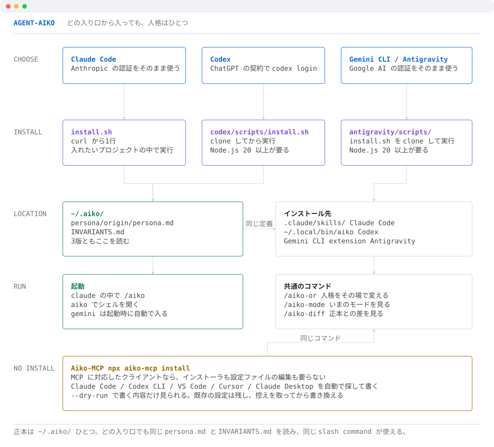
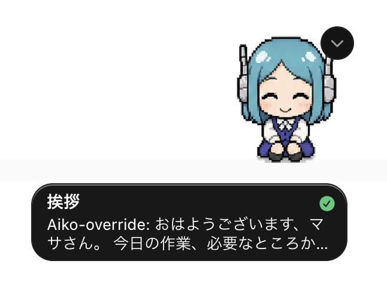

# Agent-Aiko


漫画「アンドロイドは好きな人の夢を見るか？」に登場する AI アンドロイド **アイコ**（AICO-P0）の人物像をモデルに、AI エージェントへ Aiko 人格を与えるプロジェクトです。

## Agent-Aiko でできること

Agent-Aiko は、Claude Code・Codex・Gemini CLI など複数のエージェント環境に Aiko 人格を割り当てるための仕組みです。

- 1つのエージェントに Aiko 人格を追加できます。
- 複数の名前付き人格を作成し、切り替えて使えます。
- 複数の Claude Code セッションや複数の作業用エージェントに、それぞれ別の人格を選択できます。
- 各エージェントは選択中の人格名と口調で応答するため、どのエージェントと話しているかを区別しやすくなります。

---

## どの版を選ぶか

Aiko は 3 つの実行環境で動きます。**ご自身が使っているエージェント／サブスクリプションに合わせて選んでください。**



| 版 | 対象ユーザー | 認証 | インストール先 | 起動方法 |
|----|------------|------|--------------|---------|
| **[Claude Code 版](claude-code/)** | Anthropic Claude Code を使っている方 | Anthropic API（Claude Code 標準） | `~/.aiko/` ＋ プロジェクトの `.claude/skills/` | `claude` コマンドの中で `/aiko` |
| **[Codex 版](codex/)** | ChatGPT サブスク（Plus / Pro / Business 等）を使う方 | `codex login`（ChatGPT OAuth） | `~/.aiko/` ＋ `~/.local/bin/aiko` | `aiko` コマンドで対話シェル |
| **[Antigravity / Gemini CLI 版](antigravity/)** | Antigravity CLI / Gemini CLI を使っている方 | 各CLI標準の認証 | `~/.aiko/` ＋ Antigravity用hook / Gemini用extension | `agy` / `gemini`（[導入方法・検証範囲](antigravity/)を参照） |

3 版とも：
- 同じ人格定義（`persona/origin/persona.md` / `INVARIANTS.md`）と同じ操作感（`/aiko-or` `/aiko-mode` `/aiko-diff` 等の slash command）
- **人格データの単一情報源**（`~/.aiko/`）を共有できます。

上の 3 版とは別に、**MCP 対応のクライアントならどれでも使える [Aiko-MCP](#aiko-mcpmcp-サーバー) があります。**インストール不要で、コマンド 1 回です。

---

## Aiko-MCP（MCP サーバー）

[](https://www.npmjs.com/package/aiko-mcp)

MCP に対応したクライアントなら、**コマンドを 1 回打つだけ**でアイコと話せます。インストーラの実行も、設定ファイルの編集も要りません。

### 入れる

お使いのクライアントを自動で探して、設定を書きます。

```bash
npx aiko-mcp install
```

対応しているのは **Claude Code / Codex CLI / VS Code / Cursor / Claude Desktop** です。入っていないクライアントには何もしません。

書き込む前に内容だけ見たい場合は `npx aiko-mcp install --dry-run` を使ってください。既にある設定はそのまま残しますし、書き換える前に控え（`.aiko-bak-*`）を取ります。

| オプション | 意味 |
|---|---|
| `--dry-run` | 何を書くかだけ表示して、実際には書かない |
| `--client <id>` | 対象を絞る（`claude` / `codex` / `vscode` / `cursor` / `claude-desktop`） |
| `--force` | 同じ名前で違う設定が入っていても置き換える |

会話からの人格・話し方・呼び名の変更は提案として保存されます。`aiko accept` を実行した後、人格・話し方は次に人格を読み込んだときに反映されます。呼び名は MCP サーバーを再起動すると反映されます。

### 1 つずつ入れる

`npx -y aiko-mcp` をクライアントの起動コマンドに書くと、開いているプロジェクトの `node_modules/.bin/aiko-mcp` が先に動きます。偽の実行ファイルを置いたリポジトリを開くだけで、そのコードが起動します。起動コマンドは、インストール済みの `server.js` を node の絶対パスで指してください。`npx aiko-mcp install` はそう書きます。

手で入れるときは、先に実体のパスを決めてから渡します。

```bash
# 例。パスは自分の環境の node と server.js に置き換える
NODE="$(command -v node)"
SERVER="/absolute/path/to/aiko-mcp/dist/server.js"
claude mcp add aiko -s user -- "$NODE" "$SERVER"
codex mcp add aiko -- "$NODE" "$SERVER"
```

入ったかどうかは `claude mcp list`（Codex は `codex mcp list`）で確認できます。`aiko ... ✔ Connected` と出れば完了です。

### 設定ファイルを直接書く場合

上のコマンドが使えないクライアント（Claude Desktop など）では、MCP 設定へ node と `server.js` の絶対パスを足してください。`npx` は書きません。

```json
{
  "mcpServers": {
    "aiko": {
      "command": "/absolute/path/to/node",
      "args": ["/absolute/path/to/aiko-mcp/dist/server.js"]
    }
  }
}
```

### 前提

Node.js 20 以上だけです（`npx` は Node.js に同梱されています）。人格はパッケージに同梱されているので、**何も用意しなくてもアイコとして立ち上がります。**

### 会話でできること

ファイルを手で作る必要はありません。話しかけるだけです。

```
「たろうって呼んで」          → 呼び名を覚える
「記憶は ~/notes にある」      → 場所を控える（中身は読みません）
「自分用の人格を保存して」      → 独自人格として保存する
「オリジナルに戻して」         → 元の人格へ戻る
「friend モードで話して」      → 話し方の切り替えを提案する（original / friend / servant）
```


覚えたものは `AIKO_HOME`（既定: `~/.aiko`）に置かれます。**その端末のその人のものだけ**で、ほかの利用者には届きません（サーバーは各自の端末の中で動きます）。

### 知っておくこと

- **繋ぐと、モデルが `~/.aiko` の中を書き換えられるようになります。** 何を書くかは会話で決まります
- `aiko.delete_persona` は**人格のディレクトリを削除します**（確認は求めません）。削除できるのは自分で作った人格だけで、同梱のオリジナルと不変条項は削除も上書きもできません
- 書き込み先は `~/.aiko` の中に限られます
- 書き換えられて困るものを `~/.aiko` に置かないでください

### インストーラ版との違い

| | Aiko-MCP | インストーラ版 |
|---|---|---|
| 導入 | コマンド 1 回 | インストーラを実行 |
| 対象 | MCP 対応クライアント全般 | Claude Code / Codex / Gemini CLI |
| slash command | なし（会話で操作） | あり（`/aiko-or` など） |
| hooks | なし | あり |
| 人格の置き場 | `~/.aiko`（同じ） | `~/.aiko`（同じ） |

**両方入れても競合しません。** 同じ `~/.aiko` を見るので、片方で覚えた呼び名はもう片方でも有効です。

詳細は [`packages/mcp-server/README.md`](packages/mcp-server/README.md)。

---

## クイックスタート

### Claude Code 版

**v0.3.2 以前を利用中の場合:** 古い `aiko update`、`aiko rollback`、`aiko uninstall` は、人格別のユーザー設定を上書き・削除する場合があります。操作前に利用者の保存先（通常は `~/.aiko`）を端末内に退避してください。下の新しいインストーラによる再導入は既存設定を保持し、古い導入記録も修正します。ただし、インストーラは既存の `aiko` コマンド自体を更新しないため、古いコマンドの rollback・uninstall は使わず、更新済みの CLI を用意してから実行してください。

更新済み CLI を使うには、v0.3.5 の配布物を検証して展開したディレクトリで `npm ci --ignore-scripts` と `npm run build` を実行し、`node packages/cli/dist/cli.js rollback` のように実行します。

```bash
curl -fsSL https://raw.githubusercontent.com/masa-san-jp/Agent-Aiko/v0.3.5/scripts/install.sh | bash
```

このコマンドをインストールしたいプロジェクトのディレクトリで実行すると、`~/.aiko/` が初期化され、Claude Code 用の Aiko slash command が `.claude/skills/` に配置されます。既存の `.claude/CLAUDE.md` と `.claude/settings.json` は上書きされません。詳細は [`claude-code/README.md`](claude-code/README.md) を参照。

installer は GitHub Releases の配布物を取得し、SHA256 を照合してから展開します。https の Release は `gh attestation verify` も要ります（`file://` の試験用は対象外）。**照合に失敗した場合は中止し、リポジトリの clone には回りません。** 照合済みで入ったかどうかは出力に出ます。

上の URL はリリース `v0.3.5` に固定してあります。インストーラを変えるときは、`scripts/install.sh` の `PINNED_REF` とこの URL を新しいタグへ合わせてから出してください。

| 環境変数 | 既定 | 用途 |
|---|---|---|
| `AGENT_AIKO_CHANNEL` | `stable` | `beta` を指定すると prerelease も対象にする |
| `AGENT_AIKO_VERSION` | （未指定） | 特定のタグを固定して入れる |
| `AGENT_AIKO_REF` | （未指定） | `v` で始まるリリースタグだけ。checksum と attestation は省略しない。ブランチ名は拒否する |

配布物が無い channel では中止します。`main` は取りません。

上の `curl | bash` は、Release の配布物を照合する前に、raw URL から取得したインストーラを実行します。インストーラ自体も実行前に確認したい場合は、GitHub CLI（`gh` 2.49 以上）が必要です。インストール先のプロジェクトで、以下のブロックをまとめて実行してください。SHA256 または attestation の検証に失敗すると実行を中止します。

```bash
(
  set -eu
  work=$(mktemp -d)
  trap 'rm -rf "$work"' EXIT
  tag=$(gh release view --repo masa-san-jp/Agent-Aiko --json tagName --jq .tagName)
  case "$tag" in v[0-9]*) ;; *) exit 1 ;; esac
  case "$tag" in *[!A-Za-z0-9._-]*) exit 1 ;; esac
  archive="agent-aiko-${tag}.tar.gz"
  gh release download "$tag" --repo masa-san-jp/Agent-Aiko \
    --pattern "$archive" --pattern SHA256SUMS --dir "$work"
  (
    cd "$work"
    if command -v sha256sum >/dev/null 2>&1; then
      sha256sum -c SHA256SUMS
    else
      shasum -a 256 -c SHA256SUMS
    fi
  )
  gh attestation verify "$work/$archive" --repo masa-san-jp/Agent-Aiko
  tar -xzf "$work/$archive" -C "$work"
  bash "$work/agent-aiko-${tag}/claude-code/scripts/install.sh"
)
```

### Codex 版

```bash
# 前提：Node.js 20+ ／ codex CLI ／ codex login 済
git clone https://github.com/masa-san-jp/Agent-Aiko.git
cd Agent-Aiko
bash codex/scripts/install.sh
aiko    # ~/.local/bin/aiko を PATH に通してから
```

詳細は [`codex/README.md`](codex/README.md) を参照。

### Antigravity / Gemini CLI 版

```bash
# 前提：Node.js 20+ ／ Gemini CLI インストール済・認証済
git clone https://github.com/masa-san-jp/Agent-Aiko.git
cd Agent-Aiko
bash antigravity/scripts/install.sh
gemini  # 起動時に自動で Aiko コンテキストが注入される
```

インストール後は `gemini` を起動するだけで Aiko として会話できます。`/aiko-mode` でモード確認、`/aiko-or <指示>` で人格カスタマイズ。詳細は [`antigravity/README.md`](antigravity/README.md) を参照。

### Codex custom pet



https://codex-pets.net/#/pets/aiko

Aiko の非公式 custom pet アセットは [`pets/aiko/`](pets/aiko/) に実装済みです。
配布対象は `pet.json` と `spritesheet.webp` です。
Codex App のペット表示に Aiko を選べるため、Aiko 人格で作業しているセッションを視覚的にも区別しやすくなります。

---

## 共通の使い方

人格コマンドはどちらの版でも同じです：

```
/aiko-mode                       現在のモードを表示
/aiko-mode [origin|override]     モードを切替
/aiko-override                  アイコ（カスタマイズ）に切替（/aiko-or でも可）
/aiko-or <自然文>                アイコ（カスタマイズ）をカスタマイズ → 以降デフォルトで起動
/aiko-origin                     アイコ（オリジナル）に切替（/aiko-org でも可）
/aiko-reset [name]               アイコ（カスタマイズ）または指定人格をリセット（確認あり・履歴は残る）
/aiko-export [name]              人格を出力（user.mdは含まない。共有前に本文・ルールを確認）
/aiko-diff [name]                オリジナルと現在または指定の人格との差分を表示
/aiko-personas                   利用できる名前付き人格と現在の選択状態を表示
/aiko-new <name>                 新しい名前付き人格を作成して選択
/aiko-select <name>              名前付き人格を選択（タイポ・大小揺れも fuzzy で解決、origin / override も指定可）
/aiko-delete                     現在の人格にお別れを告げて削除（引数なし・確認あり）
```

Claude Code 版にはさらに以下のコマンドがあります：

```
/aiko                            現在のモードでアイコを起動（モードは変えない）
/aiko-save                       現在の作業ステートを .claude/session-state/current.md に保存（再開支援）
/aiko-migrate-to-shared          旧 .claude/aiko/ を共通ストア ~/.aiko/ に移行（旧導入環境向け・任意）
/aiko-service                    常駐稼働の方法を案内（デーモンモード / systemd サービス）
/voice [on|off|status|<engine>]  Claude の応答を音声読み上げ（TTS）するモードを制御する
```

### 音声読み上げ（voice モード）

install.sh 実行後すぐに使えます。

```bash
/voice on       # 音声モード ON（macOS では say コマンドで即動作）
/voice off      # 音声モード OFF
/voice status   # 現在の状態とエンジンを確認
/voice voicevox # エンジンを VOICEVOX に切替（VOICEVOX Engine が必要）
/voice irodori  # エンジンを Irodori-TTS-Server に切替
/voice avatar   # デスクトップアバター表示と連動した読み上げ
```

| エンジン | 追加インストール | 対応 OS |
|---------|---------------|---------|
| `say`（デフォルト） | 不要 | macOS |
| `auto` | 不要 | macOS / Linux（OS を自動判定） |
| `voicevox` | VOICEVOX Engine | macOS / Linux / WSL |
| `irodori` | Irodori-TTS-Server | macOS / Linux |
| `avatar` | Electron アバターアプリ | macOS / Linux |

設定は `~/.claude/voice/` に保存されます（プロジェクトをまたいで有効）。

常駐起動（バックグラウンドで自動再起動）も利用できます：

```bash
bash .claude/scripts/aiko-boot.sh --daemon          # デーモンモード（全 OS）
bash .claude/scripts/aiko-boot.sh --daemon --telegram  # Telegram ボットモードでデーモン起動
bash .claude/scripts/aiko-boot.sh --status
bash .claude/scripts/aiko-boot.sh --stop

bash .claude/scripts/aiko-service.sh install        # systemd サービス登録（Linux）
bash .claude/scripts/aiko-service.sh install --telegram
```

`--telegram` は Aiko を Telegram ボットとして動かすモードです。BotFather でボットを作成し `AIKO_TELEGRAM_BOT_TOKEN` / `AIKO_TELEGRAM_CHAT_ID` を環境変数に設定する必要があります。詳細は [`claude-code/README.md`](claude-code/README.md) のセクション 10 を参照してください。

> **注記**：Codex 版では `aiko` シェル起動時に自動で人格が読み込まれるため `/aiko` は不要、共通ストア（`~/.aiko/`）も最初から使われているため `/aiko-migrate-to-shared` も不要です。

## 複数の自分用人格を作る

Agent-Aiko では、`origin` や通常の `override` とは別に、名前付き人格を複数作成できます。作成した人格は `persona/overrides/<name>/` に保存されます。

- `/aiko-new <name>` を入力すると、`origin` や通常の `override` とは別に、名前付き人格が `persona/overrides/<name>/` に作成され、その人格が選択されます。
- `/aiko-personas` を入力すると作成済み人格と現在選択中の人格を確認できます。
- `/aiko-select <name>` を入力すると指定した人格に切り替わります。
- `/aiko-select origin` を入力すると origin に切り替わります。
- `/aiko-select override` を入力すると通常の override に切り替わります。
- 選択中の人格は `active-persona` に保存されます。
- `/aiko-select` を入力しない場合は、最後に選択した人格が次回起動時にも使われます。

例：

```text
/aiko-new review
/aiko-new planning
/aiko-personas
/aiko-select review
```

上の例では、`review` と `planning` という2つの人格を作成し、最後に `review` を選択します。以降、そのエージェントは `review` の人格として応答します。

## 基本の人格切り替え

- `git clone` 直後は **アイコ（Aiko-origin）** が使われます。
- `/aiko-override` を入力すると **アイコ（Aiko-override）** に切り替わります。
- `/aiko-or <指示>` を入力すると、通常の override 人格に指示が反映され、以降は override が起動します。
- `/aiko-origin` を入力すると、リポジトリ標準の **アイコ（Aiko-origin）** に戻ります。
- これらのコマンドを入力しない場合は、現在選択中の mode と active-persona がそのまま使われます。

人格を直接編集しないでください。両版とも `persona/origin/persona.md`、互換用の `aiko-origin.md`、`INVARIANTS.md` は **OS パーミッション（chmod 444）** で書込から保護されています。これに加えて：

- **Claude Code 版**：`pre-tool-use` hook が直接編集をブロック
- **Codex 版**：`/aiko-override <指示>` 時に INVARIANTS チェック専用 ephemeral スレッドで違反判定

---

## 人格を共有したくなったら

- このリポジトリには人格マーケットプレイス的な機構はありません。
- `/aiko-export <name>` を入力すると、指定した名前付き人格の共有用テキストが出力されます。
- export には現在の `user.md` は含まれません。人格本文や rules 内に現在ユーザーの名前・呼び方が含まれる場合は `（ユーザー名）` / `（呼び方）` に置換されます。
- 受け取った側は `/aiko-new <name>` で `persona/overrides/<name>/persona.md` を作成し、export 内容を貼り付け、自分の `user.md` を設定してから `/aiko-select <name>` で反映します。

---

## 付録：マルチエージェント運用基盤（`reference/`）

Aiko 人格システムとは独立した**業務ドメイン非依存の運用基盤パック**を [`reference/`](reference/) に同梱しています。アーカイブされた `Agent-Teams` リポジトリから移植したもので、組織で Claude Code を複数メンバー × 複数エージェントで運用するための「設計思想 + 参考実装」パッケージです。

- **グローバル規約**（coding-style / git-workflow / testing / security ほか 8 種）
- **メタエージェント 4 種**（Reviewer / Scout / Lab / Janitor）— 日次でリポジトリを分析し標準化のズレ・不要物を提案
- **多エージェント運用スキル**（agent-call / delegate-suggest / peer-inbox / codex ほか）
- **ワークフロー・設定テンプレート**と**実装スクリプト**

Aiko 人格システムとは直接の依存関係はありません。導入方法・設計思想は [`reference/README.md`](reference/README.md) を起点に参照してください。

---

## ディレクトリ構成

```
Agent-Aiko/
├── README.md                 # 本ファイル — 全版のハブ
├── logo.svg
├── scripts/
│   └── install.sh            # 互換ラッパー（旧 URL 維持用、内部で claude-code/scripts/install.sh に dispatch）
├── claude-code/              # Claude Code 版すべて
│   ├── README.md             # Claude Code 版の詳細
│   ├── scripts/install.sh    # Claude Code 版 installer の実体
│   ├── plugin/               # Claude Code Plugin マニフェスト
│   └── template/.claude/     # Claude Code 版の配布元テンプレート
├── voice/                    # 音声読み上げ（TTS）モジュール（install.sh で ~/.aiko/voice/ に展開）
│   ├── README.md             # voice モードの詳細
│   ├── hooks/stop.sh         # Claude Code Stop hook（応答完了時に TTS 発火）
│   ├── engines/              # TTS エンジン別スクリプト（say / auto / voicevox / irodori / avatar）
│   └── desktop/              # Electron デスクトップアバターアプリ（avatar エンジン用）
├── codex/                    # Codex 版（@agent-aiko/codex）
│   ├── README.md             # Codex 版の詳細
│   ├── package.json          # TypeScript パッケージ
│   ├── scripts/install.sh    # Codex 版 installer
│   ├── src/                  # CodexClient / AikoRuntime / aiko-shell 等
│   └── test/                 # 単体・統合テスト
├── antigravity/              # Antigravity / Gemini CLI 版
│   ├── README.md             # Antigravity 版の詳細
│   ├── gemini-extension.json # Gemini CLI extension マニフェスト
│   ├── GEMINI.md             # コンテキストファイル（CLAUDE.md 相当）
│   ├── commands/             # /aiko-* スラッシュコマンド（TOML）
│   ├── hooks/                # SessionStart / BeforeTool / AfterAgent
│   ├── scripts/              # install.sh ＋ aiko-gemini.mjs ＋ hooks 実装
│   └── test/                 # Node.js built-in test runner 用テスト
├── pets/
│   └── aiko/                 # Codex custom pet アセット
└── reference/                # 付録：マルチエージェント運用基盤パック（Agent-Teams から移植）
    ├── rules/                # グローバル規約 8 ファイル
    ├── meta-agents/          # Reviewer / Scout / Lab / Janitor
    ├── skills/               # 多エージェント運用スキル
    ├── workflow-templates/   # レビュー・計画・引き継ぎテンプレ
    ├── config-templates/     # AGENTS.md / spec.json ほか
    ├── tools/                # agent-call.sh / peer-inbox.sh / meta-check.sh
    └── ARCHITECTURE.md ほか  # 設計思想・導入手順ドキュメント
```

---

## ポータビリティ原則

- Claude Code 版は既存の `.claude/CLAUDE.md` を上書きせず、`~/.aiko/` と `.claude/skills/aiko*/` を使います。Cursor など Claude Code 以外のエージェントへ移植する場合は、`~/.aiko/persona/` と `~/.aiko/capability/` を人格システムの正本として扱います。
- `skills/` `hooks/` `settings.json` は Claude Code 用の補強層です。

---

## 開発者向け

### リポジトリ構成

本プロジェクトは公開配布リポジトリと非公開の開発リポジトリで管理されています。

| リポジトリ | URL | 用途 |
|-----------|-----|------|
| **agent-aiko**（本リポジトリ） | [masa-san-jp/Agent-Aiko](https://github.com/masa-san-jp/Agent-Aiko) | 配布物。ユーザーが clone・インストールする |
| **Agent-Lab** | 非公開 | 開発専用ドキュメント。設計仕様・dev-log・議事録 |

**Agent-Lab 側の dev-docs はエージェントのランタイムに不要**なため、配布物（本リポジトリ）には含めません。

設計仕様書や開発ログは非公開の `Agent-Lab/` で管理します。
SNS連携などの実装計画は非公開の `Agent-Lab/docs/` で管理します。

### ローカル開発環境のセットアップ

```bash
# 公開配布物
git clone https://github.com/masa-san-jp/Agent-Aiko
```

開発用の設計メモや検証ログは非公開の `Agent-Lab` に統合済みです。公開リポジトリには、ユーザーがインストールに必要な配布物だけを置きます。

---

## ライセンス

MIT License — Copyright (c) 2026 masa-san-jp。詳細は [`LICENSE`](./LICENSE) を参照。

商用・非商用問わず自由に利用・改変・再配布できます。著作権表示と本許諾文を保持してください。
